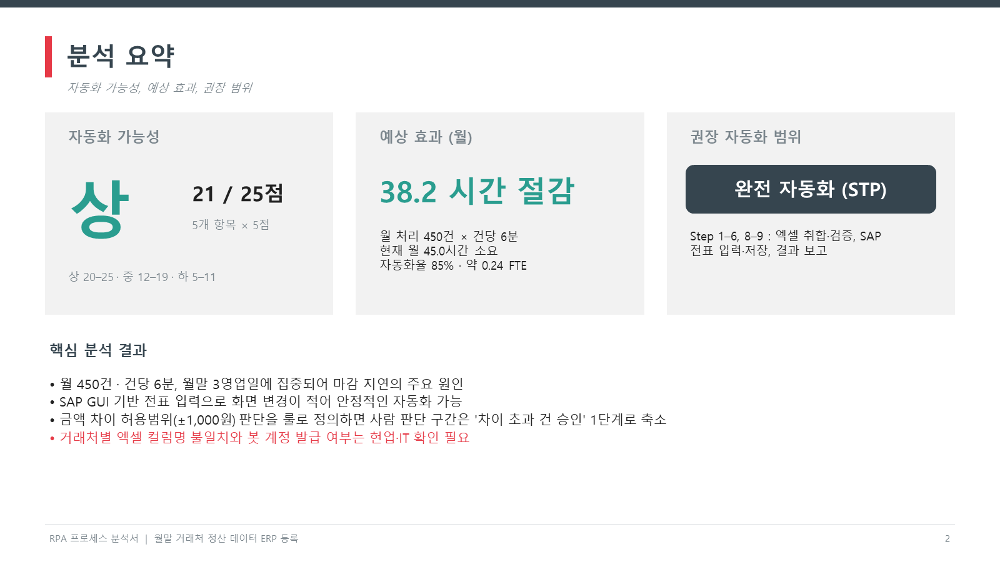
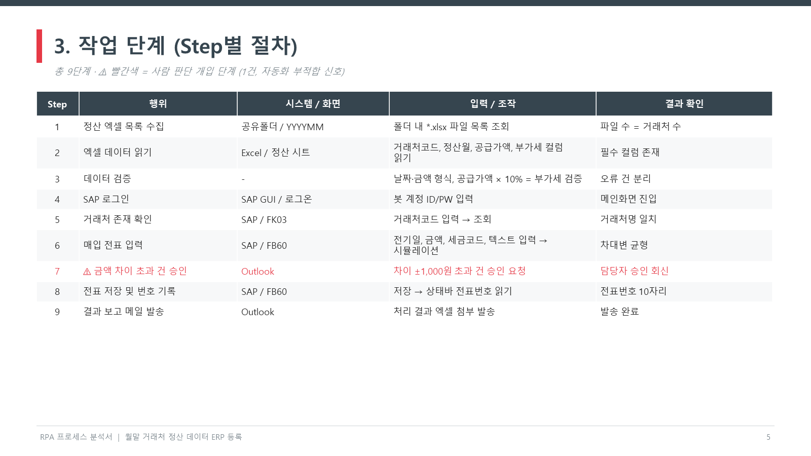
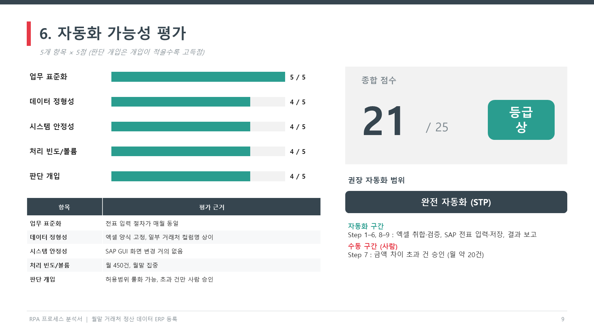
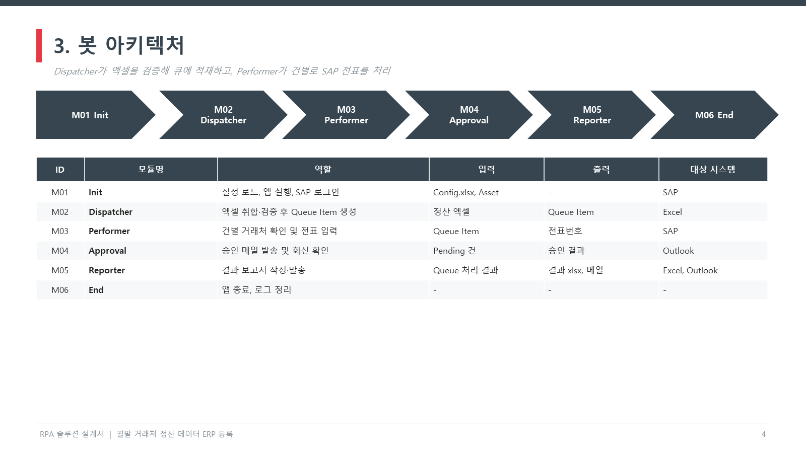

# RPA Pre-Development Toolkit (Claude Code Plugin)

RPA 프로젝트의 **개발 전 단계**를 Claude Code와 함께 수행하는 플러그인입니다.
현업 자료를 넣으면 과제 평가표(Excel), 프로세스 분석서 PDD(PPT), 솔루션 설계서 SDD(PPT)를 표준 양식으로 만들어 줍니다.

> A Claude Code plugin that turns business-user materials into RPA pre-development deliverables:
> opportunity assessment workbook (Excel), Process Design Document and Solution Design Document (PowerPoint). Korean-first.

```
 1. 과제 발굴          2. 타당성 평가          3. 프로세스 분석          4. 솔루션 설계
 ───────────────  →  ────────────────  →  ──────────────────  →  ──────────────────
 조사 양식·인터뷰       5개 항목 25점 평가      7개 분석 항목             To-Be·봇 아키텍처
 1차 스크리닝          ROI·FTE·우선순위        "확인 필요" 도출           예외·로그·보안·테스트
 ▼                    ▼                      ▼                        ▼
 RPA_과제평가표.xlsx ──────────────┘        RPA분석서_*.pptx          RPA설계서_*.pptx
```

| 슬래시 명령 | 하는 일 | 산출물 |
|------|------|------|
| `/rpa-predev:guide` | 전체 흐름 안내, 현재 상황에 맞는 단계로 연결 | — |
| `/rpa-predev:discovery` | 현업 조사 양식 생성, 조사서·인터뷰 메모에서 후보 업무 추출, 1차 스크리닝 | `assessment.json`, `RPA_과제평가표.xlsx` |
| `/rpa-predev:feasibility` | 5개 항목 채점(근거 포함), ROI·FTE·절감액, 우선순위 | 평가표 갱신 |
| `/rpa-predev:process-analysis` | 현업 업무 설명 PPT → 봇 관점 Step 분해, 예외·리스크, 인터뷰 필요 항목 | `RPA분석서_<업무명>_v1.0.pptx` |
| `/rpa-predev:solution-design` | PDD → To-Be, 모듈 구조, 설정·큐, 예외 처리, 로그·알림, 환경, 보안, UAT, 일정 | `RPA설계서_<업무명>_v1.0.pptx` |

명령을 직접 입력하지 않아도 "이 업무 자동화 가능한지 봐줘", "과제 우선순위 정해줘"처럼 말하면 해당 스킬이 동작합니다.

## 미리보기

| PDD 분석 요약 | PDD 작업 단계 (⚠ = 사람 판단 개입) |
|---|---|
|  |  |
| **PDD 자동화 가능성 평가** | **SDD 봇 아키텍처** |
|  |  |

과제 평가표(Excel)는 `안내 / 과제목록 / 타당성평가 / ROI / 우선순위 / 확인필요 / 현업작성양식` 7개 시트로 구성되며,
점수·자동화율·인건비를 바꾸면 총점·등급·ROI·우선순위가 **Excel 수식으로 자동 재계산**됩니다.

## 설치

### 1) Python 패키지

```bash
pip install python-pptx openpyxl
```

Python 3.9 이상. 미리보기(시각 QA)에는 Windows의 Microsoft PowerPoint 또는 LibreOffice가 있으면 사용되며, 없어도 문서 생성은 됩니다.

### 2) 플러그인

Claude Code 세션에서:

```
/plugin marketplace add mikikim88/rpa-predev-toolkit
/plugin install rpa-predev@rpa-toolkit
```

터미널에서:

```bash
claude plugin marketplace add mikikim88/rpa-predev-toolkit
claude plugin install rpa-predev@rpa-toolkit
```

Claude 데스크톱 앱(Code 탭)에서는 프롬프트 입력창 옆 **+ → Add plugins**에서 마켓플레이스를 추가할 수 있습니다.

## 사용 예

```
/rpa-predev:discovery 재무팀 배포용 업무 조사 양식 만들어줘
/rpa-predev:discovery 회수한 조사서들(조사서_*.xlsx) 정리해서 과제 목록 만들어줘
/rpa-predev:feasibility 시간당 인건비 35,000원 기준으로 우선순위 매겨줘
/rpa-predev:process-analysis 거래처정산_업무설명.pptx 분석해서 PDD 작성해줘
/rpa-predev:solution-design UiPath 기준으로 SDD 만들어줘
```

## 동작 방식

Claude가 자료를 분석해 **JSON 명세**(`assessment.json` / `pdd.json` / `sdd.json`)를 작성하고,
번들된 Python 스크립트가 이를 일관된 디자인의 Excel·PPT로 렌더링합니다.

- JSON이 산출물의 원본입니다. 수정은 JSON을 고쳐 다시 렌더링하고, 인터뷰 후 `meta.version`을 올립니다.
- 자료에 없는 값은 비워 두며, 문서에 **빨간색 "확인 필요"**로 표시되고 "현업 인터뷰 필요 항목"에 모입니다.
- 스크립트는 Claude 없이도 직접 실행할 수 있습니다:

```bash
cd plugins/rpa-predev
python scripts/build_assessment.py examples/assessment.json -o 과제평가표.xlsx
python scripts/build_assessment.py --intake-template -o 현업작성양식.xlsx
python scripts/read_intake.py 조사서1.xlsx 조사서2.xlsx -o assessment.json
python scripts/render_pdd.py examples/pdd.json -o PDD.pptx
python scripts/render_sdd.py examples/sdd.json -o SDD.pptx
python scripts/extract_pptx.py 업무설명.pptx --images images/
python scripts/preview_pptx.py PDD.pptx -o preview/
```

JSON 형식: [assessment](plugins/rpa-predev/skills/feasibility/references/assessment-schema.md) ·
[pdd](plugins/rpa-predev/skills/process-analysis/references/pdd-schema.md) ·
[sdd](plugins/rpa-predev/skills/solution-design/references/sdd-schema.md) ·
예시: [`plugins/rpa-predev/examples/`](plugins/rpa-predev/examples/)

## 평가 기준

| 항목 | 5점 | 3점 | 1점 |
|------|-----|-----|-----|
| 업무 표준화 | 절차가 명확히 정형화 | 일부 변동 | 매번 다름 |
| 데이터 정형성 | 정형 100% | 일부 비정형 | 비정형 위주 |
| 시스템 안정성 | 변경 적음 | 가끔 변경 | 자주 변경 |
| 처리 빈도/볼륨 | 고빈도·고볼륨 | 중간 | 저빈도·소량 |
| 판단 개입 | 거의 없음 | 룰 기반 판단 | 사람 판단 필수 |

등급: **상** 20–25 (완전 자동화) · **중** 12–19 (부분 자동화 / RDA) · **하** 5–11 (프로세스 개선 선행)
기준을 바꾸려면 `scripts/scoring.py`를 수정하세요.

## 문제 해결

- **`PackageNotFoundError: ... pptx/templates/default.pptx`** — 사내 문서보안(DRM)이 python-pptx 설치 파일의
  템플릿을 암호화한 경우입니다. 가상환경을 새로 만들어 설치하거나(`python -m venv .venv`) DRM 예외 경로에 설치하세요.
- **생성한 PPT/Excel을 다른 PC에서 열 수 없음** — DRM이 적용된 폴더에서 생성된 파일입니다. 외부 공유 시 사내 반출 절차를 따르세요.
  이 때문에 저장소에는 샘플 Office 파일을 넣지 않고 `.gitignore`로 제외합니다.
- **미리보기가 안 됨** — PowerPoint(Windows) 또는 LibreOffice가 필요합니다. 없으면 Claude가 텍스트 추출로 대신 점검합니다.

## 개발

```bash
pip install python-pptx openpyxl pytest
python -m pytest tests -q
claude plugin validate .                        # 마켓플레이스 검증
claude plugin validate ./plugins/rpa-predev     # 플러그인 검증
```

## License

MIT
